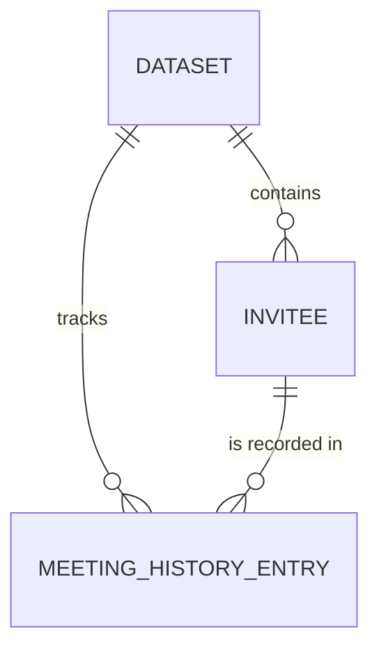

# Entity Model

> **Note on provenance:** this application has no database. These entities
> model the application's actual durable state: the browser's own storage
> (dataset selection and meeting history) and the invitee data loaded at
> startup. Reverse-engineered from `src/app.js` (`StateManager`,
> `fetchPartners`, `DATASETS`) rather than from a schema.

## Entity Relationship Diagram

### DATASET

One of the two disjoint sets of invitees: the Partners or the Lead Developers.

| Attribute | Description                                                                 | Data Type | Length/Precision | Validation Rules                            |
| --------- | --------------------------------------------------------------------------- | --------- | ---------------- | ------------------------------------------- |
| key       | Unique identifier for the dataset, used as the key into the persisted state | String    | -                | Primary Key                                 |
| label     | Display label shown on the dataset's tab and section heading                | String    | -                | Not Null, Values: Partners, Lead Developers |

### INVITEE

A Partner or a Lead Developer whom the wheel can select for a 1:1 meeting.

| Attribute   | Description                                                                                  | Data Type | Length/Precision | Validation Rules                    |
| ----------- | -------------------------------------------------------------------------------------------- | --------- | ---------------- | ----------------------------------- |
| id          | The invitee's email address; the stable identifier across page reloads                       | String    | -                | Primary Key                         |
| dataset_key | Dataset the invitee belongs to; Partners hold Partners, Lead Developers hold Lead Developers | String    | -                | Not Null, Foreign Key (DATASET.key) |
| name        | Display name derived from the email's local part (see UC-001 BR-002)                         | String    | -                | Not Null                            |

#### Constraints

- An invitee belongs to exactly one dataset: a Partner is never a Lead Developer and vice versa (UC-001 BR-005). Not yet enforced by the implementation.
- An invitee whose id (email) ends in an excluded domain (currently `finanteq.com`) is filtered out before the dataset is shown and is never part of this set.

### MEETING_HISTORY_ENTRY

A record that a specific invitee was met via a dataset's wheel, used to avoid repeat selections and to populate the "Recently Met" list.

| Attribute   | Description                            | Data Type | Length/Precision | Validation Rules                       |
| ----------- | -------------------------------------- | --------- | ---------------- | -------------------------------------- |
| dataset_key | Dataset this history entry belongs to  | String    | -                | Primary Key, Foreign Key (DATASET.key) |
| invitee_id  | Invitee this entry refers to           | String    | -                | Primary Key, Foreign Key (INVITEE.id)  |
| met_at      | Date and time the meeting was recorded | DateTime  | -                | Primary Key                            |

#### Constraints

- Composite primary key: (dataset_key, invitee_id, met_at).
- The entry's dataset_key equals the dataset_key of its invitee.
- At most 10 entries are retained per dataset; when a new entry would exceed 10, the oldest entry for that dataset is discarded.
- Entries are ordered most-recent-first by met_at when displayed.
